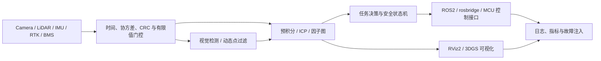

# 李梓鹏｜具身智能、机器人系统与边缘 AI 作品集

[](https://github.com/lemonbaby2/-123/actions/workflows/ci.yml)
[](https://www.python.org/)
[](https://isocpp.org/)
[](LICENSE)

[English](README_EN.md) · [具身智能工程档案](embodied-ai/README.md) · [研究与开源资料](docs/RESEARCH.md) · [简历证据映射](docs/RESUME_EVIDENCE_MATRIX.md) · [复现清单](docs/REPRODUCTION_CHECKLIST.md) · [本轮全量实跑报告](docs/ROUND2_FULL_RUN.md) · [可跑性账本](docs/RUNNABILITY_LEDGER.md) · [离线压缩包](dist/lizipeng-embodied-ai-portfolio.zip)

**2026 简历项目总索引：**[源码、演示与结果状态](docs/RESUME_2026_PROJECT_INDEX.md)。该索引逐项标明已公开的代码、可重复的演示，以及尚未找到原始代码或评测证据的项目；宁波 SOP 的公开源码保存在本仓库的独立分支。

这是依据个人简历、GOAI 具身赛事实战和 3DGS 扫描仪软硬件资料整理的公开技术作品集，覆盖机器人 SLAM、多传感器融合、服务机器人控制、工业视觉、ROS2/3DGS 可视化、嵌入式 BMS、园区自主巡检和 3DGS 扫描仪工程资料。仓库不是把八个项目塞进一个共享 Python 包：**每个项目都有自己的源码、测试、配置和运行说明，可以单独阅读、单独运行、单独迁移。**

> 真实性边界：本仓库代码是为公开展示而编写的 clean-room 最小实现，不含任职单位生产源码、客户数据、设备凭据、未公开模型权重、地图或专利正文。简历中的实机成绩统一标记为“历史报告值”；只有由本仓库测试直接生成的结果才称为“仓库实测”。合成输入用于检查算法接口和异常处理，不冒充真实设备基准。

## Datawhale MicroDuck 第 85 期组队学习

[Task1 篮球平衡与 Task2 浏览器物理扰动的笔记、课程 Notebook、复现说明及结果](datawhale_microduck/README.md)已单独归档。它们是学习记录，不属于下方八个简历项目的实机成绩；第三方模型与素材保留独立来源和许可说明。

## 具身智能工程档案

[`embodied-ai/`](embodied-ai/README.md) 是与源码分开存放的三类材料：**简历全文**、**真实实验数据**、**结对开发对话**。分开的理由是证据强度不同——声明、实测、过程记录不能混着看。

| 内容 | 位置 | 要点 |
|---|---|---|
| 简历逐字转录 + 仓库映射 | [embodied-ai/RESUME_2026_FULL.md](embodied-ai/RESUME_2026_FULL.md) | 3 页 PDF 全文，每条简历条目标明「可验证 / 未公开」 |
| MicroDuck 短跑实验 | [embodied-ai/experiments/microduck_sprint](embodied-ai/experiments/microduck_sprint/README.md) | DGX Spark 上 mjlab + PPO，6 份 JSON、5 张图；同条件对照 **3.09×** |
| 具身智能对话档案 | [embodied-ai/dialogues/INDEX.md](embodied-ai/dialogues/INDEX.md) | 从 304 个会话筛出 33 个，已脱敏 |
| 双栏投稿稿 | [embodied-ai/papers](embodied-ai/papers/) | 由实验数据脚本生成，非手写数字 |

另有两处相关材料，用途不同：**简历**既有脱敏文本 [docs/RESUME.md](docs/RESUME.md)（联系方式打码，可直接公开）也有逐字全文 [embodied-ai/RESUME_2026_FULL.md](embodied-ai/RESUME_2026_FULL.md)（带项目→目录映射）；**对话**既有按主题成文的人工精选 [docs/embodied_ai_dialogues/](docs/embodied_ai_dialogues/README.md)（8 篇），也有机器抽取的全量会话 [embodied-ai/dialogues/](embodied-ai/dialogues/INDEX.md)（33 个，可追溯原话）。

MicroDuck 那组实验的两条结论值得单列：

1. **奖励权重决定"愿不愿意跑快"** —— 腾空奖励给到 5.0，策略学会站着踮脚刷分，回合奖励涨到 49.36 而实测速度从 0.135 掉到 0.091 m/s；
2. **命令覆盖决定"能不能跑快"** —— 同一个检查点，测速命令超出训练分布后速度掉 61%。

> 该实验**没有**达到社区公开的 2.07 m/s（当前 250 迭代、GB10 统一内存、口径不同），倍数是 v1↔v2 内部对照，不对外部成绩作比较。

## 2026-11-21 本机全量实跑（本轮新增，全部真实）

### 为什么先说边界：本机跑不全 16 个项目

本机硬件是 **1 张 RTX 4060 8GB**（GPU1 报 `GPU is lost`），系统 Python 3.13 无 torch，远端 DGX 全部服务端口不可达。
因此简历中需要多卡 DGX、LeRobot 数据集、50k+10k 步 VLA 训练权重、TensorRT engine、Vicon 真值、100h 长稳日志的项目，**在本机物理上无法执行**。
本轮的做法是：**把本机真能跑的全部跑全，把跑不了的逐条写清楚，绝不把演示数据包装成实机成绩。**

| 项 | 实测值 |
|---|---|
| GPU | `NVIDIA GeForce RTX 4060, 581.57, 8188, 3248, 6` |
| 本地模型 | 9 个 Ollama 模型在线（本轮实际推理 3 个） |
| 物理引擎 | MuJoCo `4.0.1` |
| 远端 DGX | 22 / 11434 / 8300 / 8085 / 18501 端口全部 `000`，不可达 |

### 实跑清单（串行执行，避免 8GB 显存争抢污染测量）

| 阶段 | 内容 | 真实结果 |
|---|---|---|
| 0 | 环境快照 | GPU / Ollama / MuJoCo / 工具链探测落盘 |
| 1 | Ollama GPU 推理基准 | 3 模型 × 冷加载 + 稳态共 24 次真实调用；GPU 采样 588 点 |
| 2 | MuJoCo 跨栏网格 | 48 组真实仿真 episode，最高分 **2.879**，越障 3 组，零跌倒 41 组 |
| 3 | Metatron coding-agent 闭环 | 本地 7B，5 轮带轨迹反馈；基线 **-0.704**，本轮最佳 **-0.704**（**未收敛，见下**） |
| 4 | 线上仓库自检 | `61` tests，PASS `58`，FAIL `3` |
| 5 | 16 条简历项目可跑性账本 | 本机可跑全 3 / 线上已验证 1 / 部分可跑 6 / 本机不可跑 6 |

> **⚠️ 本轮 Metatron 未复现收敛（如实记录，不用旧数据顶替）**
> 本轮 5 轮迭代的候选 skill **全部 REJECT**，分数始终 ≤ 基线 -0.704，跌倒率保持 1.0，最佳仍为 **-0.704**。
> 2026-11-19 那轮曾达到 +0.197 / 跌倒率 0.0，属于**独立实验日志**（`results_local_trace.json`），其随机生成结果、模型加载状态与提示词都不同，**不能算作本轮结果，也不能写成本轮性能提升**。
> 图形上 `fig3` 同时画出各组真实曲线，本轮那条是平的——这正是真实实验该有的样子：可复现的工作流 ≠ 可复现的好结果。网格搜索仍证明解存在（最高 2.879，3 组越障），只是窄可行域难以靠几次采样命中。

### 本机 GPU 推理实测（真显卡，非 CPU 空转）

| 模型 | 稳态解码吞吐（tok/s，冷加载已排除） | 冷加载耗时 | 说明 |
|---|---|---|---|
| `qwen2.5-coder:7b` | **94.3** | 48.2s | 本轮 Metatron coding-agent 用的就是它 |
| `qwen3.5:2b-q4_K_M` | **163.2** | 41.5s | 2B 最快 |
| `qwen3.5:9b-q4_K_M` | **14.1** | 127.0s | 9B 明显受 8GB 显存带宽限制 |

实跑期间 `nvidia-smi` 采样：峰值显存 **7388 MiB / 8188 MiB**，峰值利用率 **100%**，均值 **8.3%**（原始逐点数据见 `evidence/round2_gpu_samples.json`）。
8GB 显存装不下多个模型，**本轮每次切换的冷加载实测 41.5–127.0s**，这是本机做 agent 工具编排慢的直接原因。

### 8 张真实性能图（零合成数据）

| [`docs/figures/fig1_coverage_matrix.png`](docs/figures/fig1_coverage_matrix.png) | 发布覆盖矩阵：16 条简历项目 × GitHub/Gitee/真实图/指标可复现 | `coverage.json; manual audit of 38 GitHub + 28 Gitee repos` |
| [`docs/figures/fig2_ollama_gpu.png`](docs/figures/fig2_ollama_gpu.png) | 本机 Ollama GPU 推理：稳态吞吐与模型冷加载 | `benchmarks.json ollama_warm (15 real steady-state calls across 3 models; cold-load reps in benchmarks.json ollama excluded from the bar chart)` |
| [`docs/figures/fig3_metatron_convergence.png`](docs/figures/fig3_metatron_convergence.png) | Metatron coding-agent 各组真实迭代曲线与跌倒率（含本轮未收敛组） | `metatron_trial/results_*.json (5 real experiment logs, including round2_local which did NOT converge)` |
| [`docs/figures/fig4_hurdle_grid.png`](docs/figures/fig4_hurdle_grid.png) | MuJoCo 跨栏 48 组参数网格得分热力图 | `benchmarks.json metatron_grid (48 real MuJoCo episodes, this run)` |
| [`docs/figures/fig5_repo_selfcheck.png`](docs/figures/fig5_repo_selfcheck.png) | 线上仓库全量自检 PASS/FAIL 分布 | `repo_tests_full.log (ran=61, ok_suites=9, broken_cases=3, missing=['evidence/course_demo_5min.mp4'])` |
| [`docs/figures/fig6_agent_latency.png`](docs/figures/fig6_agent_latency.png) | Agent 运行时单轮延迟与工具编排可用性 | `agent_model_setup/BENCH_20261115.md (measured 2026-11-15)` |
| [`docs/figures/fig7_gpu_trace.png`](docs/figures/fig7_gpu_trace.png) | 本轮实跑期间 nvidia-smi 真实显存/利用率采样曲线 | `round2_gpu_samples.json (real nvidia-smi -i 0 sampling every 0.6s during Ollama /api/chat inference)` |
| [`docs/figures/fig8_runnability_ledger.png`](docs/figures/fig8_runnability_ledger.png) | 16 条简历项目在本机的真实可跑性账本 | `round2_full_report.json runnability_ledger (16 resume items, status assigned from real environment probes)` |

数值溯源集中保存在 `evidence/FIGURE_PROVENANCE.json`；原始数据见 `evidence/benchmarks.json`、`coverage.json`、`round2_full_report.json` 与 `evidence/logs/`。

### ❌ 这些指标本轮依然**没有**补图（铁律：不伪造）

以下简历指标在本机全盘检索后没有任何原始日志 / CSV / 权重 / engine，远端 DGX 又未授权，因此不生成任何曲线、不把简历值画成「实测」：

- Zebra：AP +12%、漏检 15%→9%、编码丢失 0.3%、Orin 42→18ms
- OpenVLA：92.5% 未见零件抓放、<60ms 端到端
- Qwen2.5-VL SOP：召回 98.2%、幻觉 <3.5%
- 世界模型：MSE -32%、PSNR 28.5dB、避碰 +25%
- 四足：回环 -63%、±3cm Vicon、100h 长稳
- BMS：SOC 误差 <2%
- LingBot-VLA：50k+10k steps、全局 batch 384、55 维适配

要补只能走两条路：① 回原设备导出 `results.csv` / TensorRT profile / Vicon bag / HIL log；② 在公开 clean-room 代码上重新评测，并明确标注「本机复测值（非简历历史值）」。

---

## 项目导航

| 项目 | 独立交付内容 | 可直接验证 | 生产/实机部分的边界 |
|---|---|---|---|
| [01 四足机器人 SLAM](projects/01_quadruped_slam/README.md) | Python SLAM 算子、C++17 体素滤波、配置、独立测试 | 体素降采样、2D ICP、IMU 积分、回环门控、决策安全接口 | 未附 CUDA、真实 ROS bag、Vicon 真值或整机控制器 |
| [02 Ginger 服务机器人](projects/02_ginger_robot/README.md) | rosbridge 消息构造、分层恢复状态机、地图路径校验、独立测试 | 链路故障定位、导航门控、路径穿越拒绝 | 仅 mock 协议，不连接真实机器人或厂商 CCU |
| [03 GeoScan Pro](projects/03_geoscan_pro/README.md) | USB-CDC 帧协议、CRC、传感器质量门控、小型因子图、独立测试 | 编解码、CRC 故障、相对/绝对约束融合 | 不是 GTSAM/iSAM2 的性能替代，也没有实测 RTK 数据 |
| [04 工业视觉](projects/04_industrial_vision/README.md) | 检测指标、P2 采样检查、INT8 量化误差、时序异常评分、独立测试 | TP/FP/FN、IoU、量化误差界、特征层检查 | 不含产线图像、YOLO 权重、TensorRT engine |
| [05 ROS2 + 3DGS](projects/05_ros2_3dgs/README.md) | ASCII PLY 解析器、MarkerArray 转换、ROS2 包骨架、自制样例、独立测试 | PLY schema、frame、时间戳单调性、ROS2 构建入口 | 示例只有 5 个自制点，不分发原项目 Lego 资产 |
| [06 STM32-FreeRTOS BMS](projects/06_bms/README.md) | Thevenin 电芯模型、AEKF、均衡逻辑、调度预算、C++17 参考实现、独立测试 | EKF 收敛趋势、温度门控、任务利用率 | 不是功能安全产品，不可直接控制电池包 |
| [07 GaussPatrol 比赛项目](projects/07_gausspatrol/README.md) | 园区闭环仿真、动态规划、定位/缺陷/地图指标、SVG/PLY、技术方案和比赛材料 | 5/5 点位、动态重规划、ATE/RPE、AP、地图完整度、13 项测试 | 当前为二维仿真；S10/LIO/YOLO/Isaac Lab/真实 3DGS 待接入 |
| [08 3DGS 扫描仪软硬件](projects/08_3dgs_scanner_soft_hardware/README.md) | BMS/SLAM 主控 PCB PDF、首板 SOP、分析报告、测试矩阵、3DGS 参考索引 | BQ76920 风险、3S2P 接线、打板清单、电源预算、HKU/HKUST/INRIA 资料索引 | 当前为资料工程化归档；缺少 Altium 源文件、Gerber、BOM、固件和实机软件 |
| [09 具身智能仿真与真机链路](projects/09_robotwin_hackathon/README.md) | Isaac Sim 4.5 适配脚本、真机采集流水线、SmolVLA/ACT 双卡训练脚本、双卡算力基准 | Isaac Sim 段错误复现与规避、SmolVLA LoRA 参数报错链、显存/算力/功耗实测、相机链路诊断方法 | 上游第三方仓库、模型权重、采集数据集、录屏未入库；网络地址与凭据已替换为占位符 |
| [10 ROS2 课程实验平台](projects/10_ros2_course_lab/README.md) | 差速车 URDF/Xacro、ros2_control、Gazebo 世界、ros_gz 桥接、里程计/前馈 PID/slam_toolbox、网页看板、5 分钟实拍录屏 | 24 项自检 PASS=24、A 段里程计误差 0.0082 %、PID 负载补偿、`/clock` 单发布者、16+13 项离线测试 | 26.04 无实测样本；录屏来自 Gazebo 仿真而非真机；私钥与内网地址已脱敏 |
| [11 R1-VLA 离线自学习 Agent](projects/11_r1_offline_agent/README.md) | 纯标准库离线 Agent：BM25 知识库问答、动作分发、依据性证书门控、20h 自强化闭环 | 断网自检 4/4 PASS、RAG 问答命中、零外部依赖 | 不含 VLA 模型权重；语料中密钥已脱敏 |
| **[12 全机 Agent 本地模型接入（本轮新增）**](projects/12_agent_runtime_2026-11/README.md) | `setup_local_models.py` 幂等接入脚本、Hermes 审批裁决容错修复说明、真实内测报告 | `--verify` 只读核验、config 语法校验、守卫裁决、单轮延迟实测 | 已脱敏；不含 `config.yaml` / `.env` / 网关 key；本地小模型不适合做主力工具编排 |
| **[13 Metatron coding-agent 复现（本轮新增）**](projects/13_metatron_coding_agent/README.md) | 物理 + 冻结执行层替身 + AST 白名单沙箱 + MuJoCo 评估 + 迭代闭环、5 组真实结果日志 | `--smoke`、48 组网格、5 轮本地 7B 迭代、云端对照 | NVIDIA 未发布 base policy 权重/MoCap，**不是论文全量复现**；DGX 链路说明已脱敏 |

## 16 条简历项目的本机可跑性账本

| R1 | LingBot-VLA 2.0 / R2 / RoboTwin | ❌ 本机不可跑 | needs DGX multi-GPU 50k+10k-step training, 50k/10k checkpoints, LeRobot dataset |
| R2 | Zebra / YOLO11-P2 + AIFI/CCFM | ❌ 本机不可跑 | needs ZT421T nozzle images/labels, trained weights, TensorRT engine |
| R3 | Cloud Ginger / CCU / OpenVLA | ❌ 本机不可跑 | needs vendor CCU API, Jetson Orin NX, AWQ quantisation log |
| R4 | GeoScan Pro / LIO-SAM + RTK | 🟡 部分可跑 | CRC / factor-graph unit tests run locally; real dual-antenna RTK needs hardware |
| R5 | World model / action-conditioned pred | ❌ 本机不可跑 | no original engineering project exists; 20+ frame / PSNR metrics have no source |
| R6 | OpenVLA language-driven manipulation | ❌ 本机不可跑 | needs 1000+ teleop trajectories and real-arm logs |
| R7 | Qwen2.5-VL industrial VQA / SOP | 🟡 部分可跑 | local Ollama VL inference benchmark runnable; 98.2% recall needs production video+labels |
| R8 | ROS2 + 3DGS Lego visualization | 🟡 部分可跑 | PLY/MarkerArray unit tests run locally; original Lego assets and Isaac Sim absent |
| R9 | Quadruped SLAM / CUDA / Vicon | 🟡 部分可跑 | voxel/ICP unit tests + C++17 build locally; Vicon ground truth and 100h log absent |
| R10 | STM32-FreeRTOS BMS | 🟡 部分可跑 | Thevenin/AEKF unit tests locally; MCU firmware and HIL rig absent |
| P1 | Paper: Dy3DGS-SLAM | 🟡 部分可跑 | repro assets published upstream; full 3DGS training needs DGX |
| P2 | Paper: TAC-R2S2R | ✅ 线上已验证 | 160 seeded runs + CSV + figures already public |
| P3 | Patents (4) / awards | ❌ 本机不可跑 | documents only; no application numbers / scans |
| A1 | Agent: R1 offline self-learning | ✅ 本机可跑全 | pure stdlib; 4/4 offline self-check PASS in repo tests |
| A2 | Agent: Hermes fix + all-agent setup | ✅ 本机可跑全 | setup_local_models.py --verify runs locally; config contains secrets -> must sanitise |
| A3 | Agent: Metatron coding-agent repro | ✅ 本机可跑全 | fully executed this run: Ollama 7B + MuJoCo 48-grid + 5-round loop |

完整字段与判定依据见 [可跑性账本](docs/RUNNABILITY_LEDGER.md) 与 `evidence/round2_full_report.json`。

## 一分钟验证

核心 Python 演示只使用标准库，要求 Python 3.10+，无需 GPU、ROS2 或下载模型：

```bash
git clone https://github.com/lemonbaby2/-123.git
cd -- -123
python scripts/verify_layout.py
python scripts/run_tests.py
python scripts/run_all_demos.py
```

Windows PowerShell 进入以连字符开头的目录时也可以使用：

```powershell
Set-Location -LiteralPath .\-123
python scripts\run_tests.py
python scripts\run_all_demos.py
```

单独运行某一个项目不需要安装根包：

```bash
python projects/01_quadruped_slam/src/quadruped_slam.py
python projects/01_quadruped_slam/tests/test_quadruped_slam.py -v

python projects/06_bms/src/bms.py
python projects/06_bms/tests/test_bms.py -v
```

构建两个独立 C++17 演示：

```bash
cmake -S projects/01_quadruped_slam/cpp -B build/quadruped
cmake --build build/quadruped
ctest --test-dir build/quadruped --output-on-failure

cmake -S projects/06_bms/cpp -B build/bms
cmake --build build/bms
ctest --test-dir build/bms --output-on-failure
```

## 仓库结构

```text
.
├── projects/
│   ├── 01_quadruped_slam/      # src + tests + config + cpp
│   ├── 02_ginger_robot/        # src + tests + config
│   ├── 03_geoscan_pro/         # src + tests
│   ├── 04_industrial_vision/   # src + tests
│   ├── 05_ros2_3dgs/           # src + tests + data + ros2_ws
│   ├── 06_bms/                  # src + tests + config + cpp
│   ├── 07_gausspatrol/          # src + tests + artifacts + docs + submission
│   ├── 08_3dgs_scanner_soft_hardware/ # hardware docs + engineering archive + references
│   ├── 09_robotwin_hackathon/   # isaac-sim-arm + lingbot-real-pipeline + vla-slam-stack + bench
│   ├── 10_ros2_course_lab/     # src + tests + ros2_ws + portal + teaching + evidence
│   ├── 12_agent_runtime_2026-11/  # 本轮新增：全机 Agent 本地模型接入（已脱敏）
│   └── 13_metatron_coding_agent/  # 本轮新增：Metatron coding-agent 复现（已脱敏）
├── scripts/
│   ├── run_all_demos.py         # 逐进程运行九个独立入口
│   ├── run_tests.py             # 验证每个项目自己的测试
│   ├── verify_layout.py         # 检查目录完整性与 README 本地链接
│   ├── build_bundle.py          # 生成确定性离线源码包和 SHA-256
│   ├── round2_full_run.py         # 本轮新增：全量实跑 runner
│   └── make_figures_round2.py     # 本轮新增：真实性能图生成器
├── embodied-ai/                 # 简历全文、实验数据、对话档案、投稿稿
│   ├── RESUME_2026_FULL.md
│   ├── experiments/microduck_sprint/   # JSON + 图 + 生成脚本
│   ├── dialogues/               # 33 个已脱敏会话
│   └── papers/
├── evidence/                      # 本轮新增：审计 + 原始 JSON / 日志 / 溯源
├── tools/
│   └── extract_dialogues.py     # 会话记录 → 脱敏档案（可重跑）
├── docs/                        # 证据边界、研究索引、复现协议、引用、简历（脱敏）
│   ├── embodied_ai_dialogues/   # 具身智能技术对话摘录（已脱敏）
│   ├── figures/                   # 本轮新增：8 张真实性能图
│   ├── ROUND2_FULL_RUN.md         # 本轮新增：完整执行报告
│   └── RUNNABILITY_LEDGER.md      # 本轮新增：16 条可跑性账本
├── dist/                        # GitHub 可直接下载的离线包
└── .github/workflows/ci.yml     # Python 3.10/3.12 + 两套 C++ 构建
```

## 系统能力地图



## 代码验收方式

仓库用四层检查避免“能展示但不能复现”：

1. `compileall` 检查所有 Python 文件可解析；
2. 八个测试入口分别启动，避免依赖根目录共享包或偶然的 `PYTHONPATH`；
3. 八个 demo 以子进程运行，输出必须是可解析 JSON；
4. 四个 CI job 分别覆盖 Python 3.10、Python 3.12、四足 C++ 与 BMS C++。

测试覆盖的是公开实现本身，例如 CRC 损坏拒绝、路径穿越拒绝、时间戳倒退拒绝、温度过高禁止均衡、ICP 位姿恢复和 INT8 误差界。它们不能证明真实硬件在所有工况下安全；实机迁移仍需 HIL、长稳、温度/功耗和失效注入。

## 指标口径：拒绝把历史成绩包装成当前实测

| 类型 | 可以怎样表述 | 本仓库做法 |
|---|---|---|
| 仓库实测 | 可由公开命令在 CI 重跑 | 只报告单元测试、JSON 演示、C++ 构建和压缩包哈希 |
| 简历历史报告值 | 来自原项目环境，但公开仓库缺少等价数据/硬件 | 在项目 README 明确标注，不声称由合成 demo 复现 |
| 设计目标 | 尚待数据或设备验证 | 写成验收条件，不写成已完成结果 |
| 参考文献结果 | 来自论文或上游项目 | 链接原始来源，不归为个人成绩 |

简历中的 10 Hz、±3 cm、回环延迟下降 63%、175 ms→48 ms、AP 提升、18 ms 和 SOC 误差 <2% 等，均需要原始数据、硬件、模型版本和统计脚本才能严格复现。完整字段见[简历证据映射](docs/RESUME_EVIDENCE_MATRIX.md)与[复现清单](docs/REPRODUCTION_CHECKLIST.md)。

## 实机复现的最低记录项

- 数据：数据集版本、采集时间、传感器固件、标定文件、时间同步方案、隐私处理；
- 软件：commit、容器/系统镜像、CUDA/cuDNN/TensorRT/ROS2 版本、编译选项；
- 硬件：设备型号、功耗模式、时钟、散热、外设拓扑；
- 评测：指标公式、样本数、预热、P50/P95/P99、随机种子、置信区间；
- 故障：丢帧、时间跳变、传感器断开、地图失败、热降频、brown-out；
- 安全：急停、看门狗、最大速度/电流、降级条件、人工接管。

## README 与工程结构参考

信息架构参考了成熟项目常用的“概览→依赖→运行→数据→故障排查→引用”顺序：

- [LIO-SAM](https://github.com/TixiaoShan/LIO-SAM)：传感器准备、依赖、数据集与运行步骤的组织方式；
- [rosbridge_suite](https://github.com/RobotWebTools/rosbridge_suite)：ROS-Web 协议项目的包结构和文档入口；
- [3D Gaussian Splatting](https://github.com/graphdeco-inria/gaussian-splatting)：环境、数据、训练/渲染和许可边界；
- [Ultralytics](https://github.com/ultralytics/ultralytics)：快速开始、任务导航、集成和许可证说明。

本仓库没有复制这些项目的受限代码。算法论文、官方文档、参考实现与许可证提醒集中在[研究资料](docs/RESEARCH.md)、[BibTeX](docs/references.bib)和[第三方说明](docs/THIRD_PARTY_NOTICES.md)。

## 下载、校验与离线使用

```bash
python scripts/build_bundle.py
python -c "import hashlib,pathlib; p=pathlib.Path('dist/lizipeng-embodied-ai-portfolio.zip'); print(hashlib.sha256(p.read_bytes()).hexdigest())"
```

压缩包只收录源码、文档、配置和自制样例；排除 `.git`、构建目录、缓存和编译产物。包内附逐文件 `SHA256SUMS.txt`，包外提供 `.zip.sha256`。

## 安全、许可与贡献

- 原创公开演示代码使用 [MIT License](LICENSE)；引用的上游项目仍受各自许可证约束。
- 3DGS 官方参考实现与 Ultralytics 等项目存在不同的商业/研究使用条款，采用前必须单独核对。
- 不要把 mock 导航、教学 ICP、简化 AEKF 或 ROS Marker 演示直接部署到安全关键设备。
- 安全问题请参阅 [SECURITY.md](SECURITY.md)，贡献流程见 [CONTRIBUTING.md](CONTRIBUTING.md)。

## 作者

李梓鹏 · [GitHub @lemonbaby2](https://github.com/lemonbaby2)

面试演示建议顺序：先执行 `python scripts/run_tests.py` 与 `python scripts/run_all_demos.py`，再进入目标项目，说明实现、边界、失败路径和实机复现方案。
