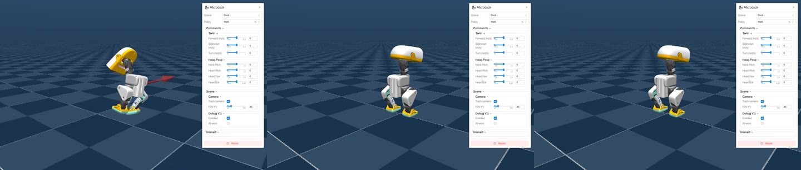

# 【Datawhale MicroDuck 组队学习】Task2：浏览器物理扰动

学习者：patient熬｜第 85 期 2 群

## 一、目标与实验边界

Task2 把 MicroDuck 的策略回放搬进浏览器，观察接触动力学和外力扰动。浏览器里运行的是 MuJoCo WebAssembly 物理、ONNX Runtime Web 策略推理和 WebGL 渲染；不是预先录好的可交互视频，也不是重新训练 PPO。鼠标拖拽时，引擎将位移映射为施加在动态刚体上的外力；松手后按当前姿态、速度、接触和策略输出继续演化。

“出现力箭头”“姿态发生变化”“重新站稳”是三个不同层级的结论。前两项只说明物理交互链路，第三项才涉及恢复能力；还须记录扰动大小、方向、作用时长、重置条件和多次试验成功率，才能形成有意义的鲁棒性评价。一次屏幕观察不能证明从仿真可迁移到真机。

## 二、接触、外力、控制闭环

每个控制周期先从 MuJoCo 状态整理策略观测，ONNX actor 给出 14 维关节动作，再交给 position actuator；MuJoCo 将重力、关节约束、足地碰撞、摩擦和拖拽外力一并积分，形成下一帧状态。拖拽外力通常写入 `mjData.xfrc_applied`，它是施加在刚体上的六维力/力矩，不等于直接改动机器人坐标，也不等于网络输出。

接触决定脚是否能建立支撑、多大的切向力会滑动以及冲击如何传到机身。外力会改变角速度、重力投影与关节状态，这些变化进入下一次策略观测；策略如果学到恢复动作，才能通过后续关节控制抵消扰动。因而这是“外力 → 动力学 → 观测 → 策略 → 动作 → 动力学”的闭环。

Task1 的篮球平衡模型与 Task2 浏览器示例的 Walk 等策略不应混为同一个 checkpoint。两者都可能使用 61→14 接口，但模型参数、场景和命令槽未必相同。仅凭形状兼容不能推断可替换。

## 三、浏览器操作与视频记录

官方在线示例：[Microduck - mjswan Cloud](https://mjswan.com/s/DOGILsh)。本地构建时，可按[课程原始说明](official_materials/README.md)运行 `msp build microduck`，通过 HTTP 静态服务访问，不能直接打开 `file://` 的 `index.html`。先确认场景、策略、模型、WASM、ONNX、WebGL 已加载，再拖拽鸭子的动态躯干，不要误选静态地面。拖拽前后分别截图；若录视频，应覆盖拖拽前、力箭头出现、松手后演化及是否重置，并标出方向与场景。

视频记录本身不是鲁棒性指标。要评估“推后站稳”，至少定义一个可重复的恢复判据（例如一定时间内躯干高度、倾角和足部接触持续位于阈值内）、固定施力协议，并重复多个随机种子和方向。强扰动导致倒下也是有效结果，应如实报告，而不是只展示成功片段。

## 四、本次操作记录

- 官方在线示例 `https://mjswan.com/s/DOGILsh` 已打开，浏览器加载了 WebGL 场景、MicroDuck 模型与控制栏，当前 Duck 场景可见 Walk 策略。
- WSL2 Ubuntu 22.04 英文路径 `/home/lizp/microduck-task2` 已安装 mjswan `0.11.9` 与 mjswan Playground。`msp list` 能列出 `microduck`，锁定上游 `microduck_rl@c690e55` 与 `microduck@590b986` 后，`msp build microduck` 成功生成 63 MB、48 个文件的静态应用；本地 HTTP 首页返回 200。
- 本地浏览器成功加载 `Duck + Walk`、WebGL 画布、策略与命令面板。交互面板明确提供 `Pull`（弹簧，N/m）和 `Push`（脉冲，N·s）两种物理扰动。手动将 Pull 弹簧调至 200 N/m 后拖拽躯干，观察到支撑脚与躯干姿态变化，松手后仍保持直立。
- 自动录制脚本执行右上提拉、左侧推拽与斜向摆动三次试验，每次之间点击 Reset。生成的 48.8 秒视频为 [MP4](recordings/mjswan_microduck_manual_drag_demo.mp4)，[关键帧](recordings/mjswan_microduck_contact_sheet.jpg)中可见红色外力箭头、机身明显倾斜/下蹲，以及扰动后的直立站姿。
- 以上是**定性鲁棒性 smoke test**：证明外力进入物理引擎，且这些可视扰动后没有立即倒地。录制没有导出力时序、躯干倾角与恢复时间，所以不报告成功率，也不能外推为真机鲁棒性金标准。
- 课程原始资料的 `microduck_duck_drag_active.png` 和录制关键帧是 Datawhale 教学资料附带的复核证据，不是本次个人实验结果。

图：本机重新录制视频的关键帧。左图可见红色外力箭头与明显姿态变化；后续画面显示 Reset 后的独立试验站姿。完整过程以 MP4 为准。

## 五、学习心得

这次任务让我更清楚地区分“能回放策略”“能施加真实物理扰动”与“策略能稳健恢复”。前两者是工具链和物理交互的验证，最后一项需要定量试验。浏览器可把接触和外力直观呈现：拖拽不是动画特效，而是引擎中刚体受力并经过接触求解后改变状态。录制中红色力箭头、机身倾斜和随后站姿说明交互闭环确实工作，但我仍只把它写成定性 smoke test。下一步应固定 Push 脉冲或 Pull 弹簧、方向、作用时间与恢复阈值，导出躯干高度/倾角和足部接触，重复多个随机种子，才能形成可比较的恢复成功率并讨论 sim-to-real。

## 六、来源与许可

- [Datawhale Task2 课程](https://github.com/datawhalechina/every-embodied/tree/main/16-%E4%B8%93%E9%A2%98%E7%BB%84%E9%98%9F%E5%AD%A6%E4%B9%A0/05-MicroDuck%E8%BF%90%E5%8A%A8%E7%AD%96%E7%95%A5%E4%B8%8E%E4%BB%BB%E5%8A%A1%E5%BC%80%E5%8F%91%E4%B8%93%E9%A2%98/01-%E4%BB%BB%E5%8A%A1%E8%B5%84%E6%96%99/02-mjswan-MicroDuck%E6%B5%8F%E8%A7%88%E5%99%A8%E7%89%A9%E7%90%86%E6%89%B0%E5%8A%A8)
- [ttktjmt/mjswan_playground](https://github.com/ttktjmt/mjswan_playground)
- [pollen-robotics/microduck](https://github.com/pollen-robotics/microduck)

上游代码、策略、网格和教学素材各有自己的许可证。本目录不把官方图片、模型或策略标为个人创作。
