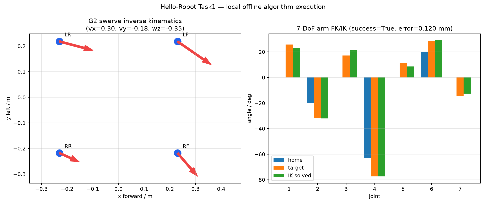
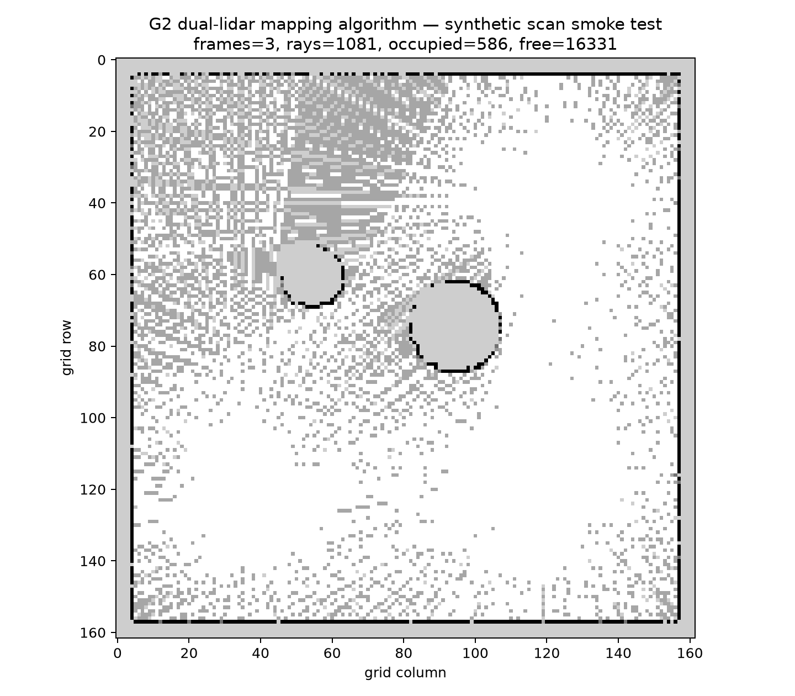

# 【Datawhale Hello-Robot 组队学习】Task1–Task5

学习者：patient熬。课程源仓库：[datawhalechina/hello-robot](https://github.com/datawhalechina/hello-robot)，本次固定参考提交：`4af2dde633e2de88f25e0c94f2994a4eb8e4fa00`。

本目录根据任务截图整理 Task1–Task5 的笔记、可重复脚本和实验结果。当前电脑有 RTX 4060 8GB，但没有 Isaac Sim、ROS 2、Qwen3-VL/π0.5/OpenPI 权重；因此本次实际执行官方纯 NumPy 教学算法，并严格区分“本机离线实测”“官方课程参考素材”和“尚未完成的完整 Isaac/模型部署”。

| 任务 | 交付 | 本机结果 | 完整仿真边界 |
| --- | --- | --- | --- |
| [Task1 环境与基本控制](task1/README.md) | G2 结构/控制笔记、底盘运动学与机械臂 FK/IK 结果图 | 4 组底盘指令正逆解；7-DoF IK 8 次迭代收敛，位置误差 0.120 mm | 未启动 Isaac Sim GUI |
| [Task2 视觉感知与建图](task2/README.md) | 感知链路笔记、二维占据栅格结果 | 3 帧、1081 条有效射线、586 个占用栅格 | 输入为确定性合成 LiDAR，不是 RTX LiDAR/YOLO 实拍 |
| [Task3 导航与机械臂规划](task3/README.md) | 两类规划对比、本机规划图、课程 RViz 参考截图 | A* 代价 11.093 m；局部绕行成功；RRT-Connect 5 次迭代成功 | 本机图为 RViz 等价离线图，不冒充 RViz 实时截图 |
| [Task4 VLM/VLA 与具身决策](task4/README.md) | VLM/VLA 笔记、3 回合数据管线、官方 π0.5 GIF | prompt 顺序与 NPZ 数据集流程通过 | 官方 GIF 不是本机 π0.5 推理；模型权重缺失 |
| [Task5 前沿算法与总结](task5/README.md) | 500 字以上总结、ACoT-VLA 离线测试记录 | 18 项测试中 17 项通过；1 项为 Windows 8.3 路径等价断言 | 未部署 ACoT-VLA/Fast-WAM 大模型 |

## 一键复现离线实验

```powershell
git clone https://github.com/datawhalechina/hello-robot.git E:\hello-robot-reference
python -m pip install numpy pillow matplotlib
python hello_robot_tasks\scripts\run_offline_validations.py `
  --source-root E:\hello-robot-reference `
  --output hello_robot_tasks\artifacts
```

机器可读总报告：[offline_validation_report.json](artifacts/offline_validation_report.json)。任务截图原件归档在 [`source_requirements/`](source_requirements/)。

## 结果图






