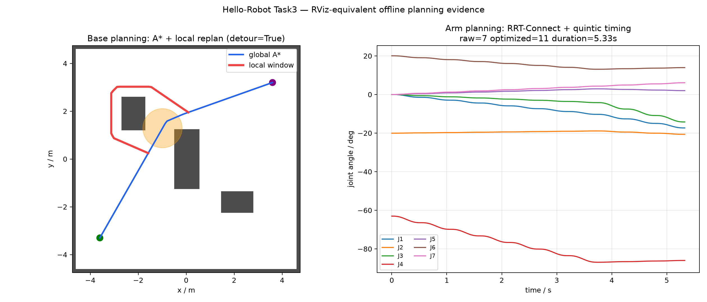
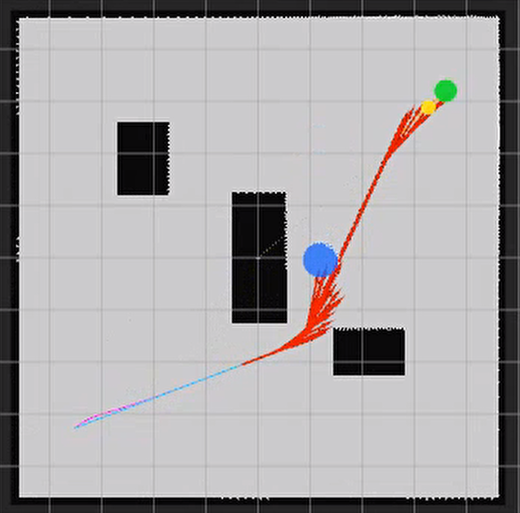
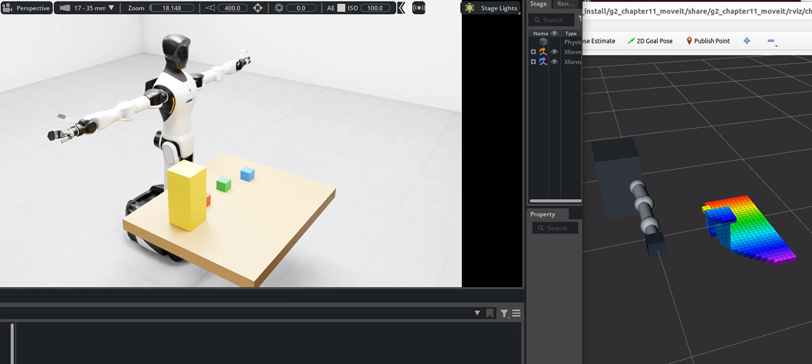

# Task3：G2 自主导航与机械臂规划

## 底盘规划与机械臂规划的区别

| 项目 | 底盘移动规划 | 机械臂规划 |
| --- | --- | --- |
| 状态空间 | 常用二维/SE(2)：`x, y, yaw` | 7 维关节空间，或 6D 末端位姿约束 |
| 障碍表达 | 二维占据栅格、膨胀层、动态圆形障碍 | 连杆胶囊、场景 AABB、自碰撞与关节限位 |
| 全局算法 | A* / Nav2 全局规划器 | RRT-Connect / OMPL / MoveIt 2 |
| 局部阶段 | 滚动窗口避障、速度采样、路径跟踪 | 路径修复、捷径优化、时间参数化、关节闭环 |
| 主要失败 | 无路、局部极小、定位漂移、动态阻塞 | IK 不可达、碰撞、奇异位形、关节超限 |

二者都遵循“状态估计 → 碰撞模型 → 全局候选 → 局部修正 → 轨迹跟踪 → 反馈重规划”的闭环，但底盘强调地图拓扑和动态避障，机械臂强调高维配置空间和连杆碰撞。

## 本机规划结果

更新：新增[计算轨迹回放视频](../artifacts/task3_trajectory_playback.mp4)。视频逐帧使用本机求得的路径与关节轨迹绘制，画面标注离线数值可视化；尚未验证物理接触与控制器跟踪。新验收检查全局/局部路径无碰撞、机械臂优化路径无碰撞和轨迹时间严格递增，报告保留实际碰撞检查范围。

- 底盘：A* 展开 7115 个节点，路径代价 `11.093 m`；加入动态障碍后，滚动窗口局部规划产生 61 点绕行路径，`blocked=false`。
- 机械臂：预抓取 IK 误差 `0.982 mm`；RRT-Connect 5 次迭代找到 7 个原始路点，优化为 11 个路点并生成 648 个五次时间参数化轨迹点，总时长 `5.327 s`。
- 本机结果图是从官方纯 NumPy 算法生成的 RViz 等价可视化，不是 ROS 2/RViz 实时截图。

## 课程 RViz 参考截图

以下两张图来自 Hello-Robot 官方教程固定提交，仅用于对照完整 Isaac/ROS 2 环境中的显示效果。

