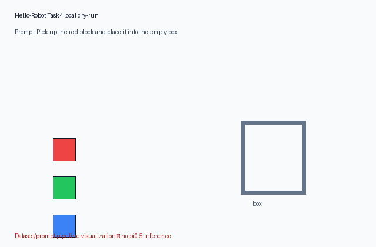
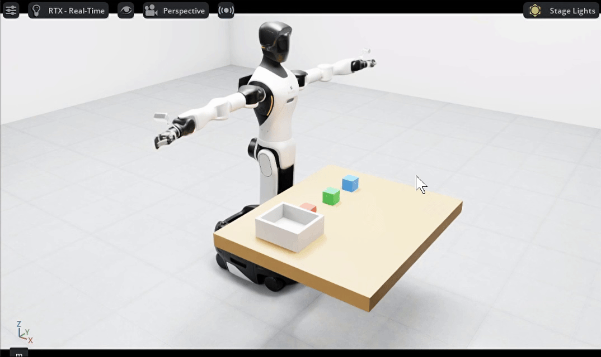

# Task4：G2 任务规划与具身决策

## VLM、VLA 与训练流程

VLM 将图像和文本映射到语义描述、问答或高层任务计划；它能回答“看到了什么、下一步应该做什么”，但通常不直接产生稳定的低层控制量。VLA 在视觉与语言条件上继续输出动作序列或动作块，需要把机器人状态、相机图像、语言指令和动作严格对齐。课程的 π0.5 路线属于 VLA：采集多相机图像、16 维状态/动作和任务 prompt，转换为训练数据格式，计算归一化统计量，微调策略，然后以服务/客户端方式闭环推理。

本地部署 Qwen3-VL 或 π0.5 还需要模型权重、足够显存、Isaac Sim 相机数据和 OpenPI 运行时。当前 RTX 4060 只有 8GB，且仓库不含权重，所以没有声称完成大模型推理。

## 本机可重复的离线验证

更新：合成回合的 `success` 统一为 `false`，总报告使用 `physical_success_evaluated=false` 表明未做物理成功评估；prompt 顺序通过单独的 `prompt_sequence_complete` 字段记录。合成数据不能作为抓取成功样本。

脚本实际运行了官方 `TaskIntent` 与 `EpisodeRecorder`：依次生成 red、green、blue 三条 pick-and-place prompt；每回合写入三路图像、16 维状态与16 维动作，共 3 个 NPZ、每个 6 帧，并生成 manifest。验证结果见 [`task4_dry_run/manifest.json`](../artifacts/task4_dry_run/manifest.json) 和总报告的 `task4` 字段。

这验证了提示词分解、数据维度和落盘流程，但不包含 π0.5 权重，也不是策略成功率。

上图由本机 dry-run 数据流程生成，用来展示三阶段 prompt/回合顺序；图内也明确标注没有执行 π0.5 推理。

## 官方 π0.5 成功演示（课程参考）

该 GIF 复制自 Hello-Robot 官方仓库 `assets/pi0.5.gif`，仅作为课程的成功运行参考，不是本机生成。

