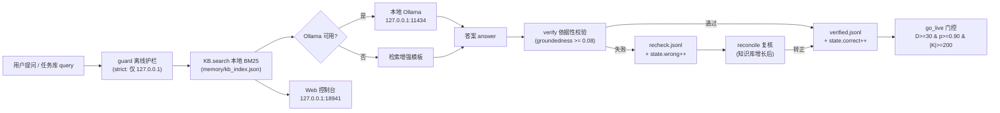

# 11｜R1-VLA 离线自学习 Agent：断网可跑的机器人 VLA 大脑

> 纯 Python 标准库实现的离线自主 Agent：**断网也能答疑、试错、记忆、决策上线**。
> 零第三方依赖、零模型下载、零外联——所有检索、合成、校验、门控都在本机完成。

---

## 项目定位与要解决的问题

工业机器人在现场常遇到一个尴尬局面： WiFi 断了、云端 API 不可达时，现场人员的问题（"这个权重能不能直接用？""当前检查点为什么速度掉一半？"）就没人答了。本 Agent 针对的正是这个痛点——把"能不能用"的判据从云端搬到本地。

它要解决的不是通用聊天，而是三个具体工程问题：

1. **离线答疑**：知识库全部落在本地 `memory/`，用纯 Python BM25（ASCII 词 + 中文 bigram）检索，答案必须能追溯到知识库段落，库外事实一律不编。
2. **自主决策与执行**：内置动作分发器（`answer` / `daily_vla` / `ingest` / `reconcile`），能触发每日 VLA 验收、吸收新文档、复核历史错误项，而不只是"问一句答一句"。
3. **自我强化与上线门控**：每天内测窗口（默认 20h）对任务库反复试错——正确固化、错误标记待复核；满 30 天且精确率、知识覆盖同时达标才允许标记 `go_live`。

设计目标写死在 `start.py` 文件头："无 WiFi / 无外网也能回答、试错、记忆、上线"。

---

## 核心能力

- **离线网络护栏**：`guard.install(strict=True)` 后，任何指向非回环地址的 `socket.connect` 都被拒绝（`PermissionError`），仅放行 `127.0.0.1` / `::1` / `localhost`；可选放行 Tailscale。
- **本地 BM25 检索**：`KB.search()` 用倒排索引 + BM25打分（`k1=1.5`、`b=0.75`），中文用相邻字符 bigram 分词，中英混排可查；索引固化在 `memory/kb_index.json`，断网重建无压力。
- **双路答案合成**：`synthesize()` 优先本地 Ollama（`http://127.0.0.1:11434/api/generate`），无模型或严格离线时自动降级为"检索增强模板"，两者都只走回环地址。
- **依据性自我校验**：`verify()` 计算答案词元与检索段落的重叠率 `groundedness`，阈值 **0.08**；拒答措辞、过短答案（<6 字符）、无检索依据一律判失败。
- **动作分发**：`Agent.act()` 支持 `answer` / `daily_vla` / `ingest` / `reconcile` 四类，未知动作返回 `{"error": "unknown action"}`。
- **20h 自强化闭环**：`selflearn.run()` 按任务库循环试错，结果分流到 `verified.jsonl`（正确）与 `recheck.jsonl`（错误），累计在 `state.json`。
- **历史错误复核**：`selflearn.reconcile()` 在知识库增长后重新核对 recheck 项，通过则转正并保留 `corrected_answer`。
- **三项上线闸门**：`go_live = 1[天数≥30 ∧ 精确率≥0.90 ∧ 索引词表≥200]`，三项缺一不可。

---

## 系统架构



数据流要点：`start.py` 先装护栏 → 载入/首次构建知识库（`corpus/` 吸收进 `memory/`）→ 构造 `Agent` → 按命令行参数选择 Web 控制台、自学习循环或单次动作 → 所有结果落盘在 `memory/`。

---

## 目录结构

```
R1-VLA离线自学习Agent_20261115/
├── start.py                       # 完整启动入口（argparse 分发）
├── test_offline.py                # 四项离线合规自检
├── install.bat                    # Windows 一键安装 + 注册每日计划任务
├── start.bat                      # Windows 一键启动控制台 + 后台自学习
├── core/
│   ├── __init__.py                # 导出 KB / Agent / install_guard / selflearn
│   ├── kb.py                      # 纯标准库 BM25 倒排索引（186 行）
│   ├── agent.py                   # 思考-行动闭环 + 动作分发（80 行）
│   ├── llm.py                     # 本地 Ollama / 模板兜底双路合成（57 行）
│   ├── verify.py                  # 依据性 + 拒答 + 矛盾启发式校验（48 行）
│   ├── selflearn.py               # 20h 试错循环 + 分流记忆 + 上线门控（159 行）
│   ├── guard.py                   # 进程内 socket 外联拦截（64 行）
│   └── web.py                     # 仅回环的 ThreadingHTTPServer 控制台（92 行）
├── corpus/                        # 知识库源语料（首次启动自动吸收）
│   ├── 01_全部提问_全量清单.md       # 32,108 行提问归档
│   ├── 08_顶刊与优秀论文_精选清单.md
│   ├── 10_2026前沿VLA与世界模型_核实报告.md
│   ├── 11_VLA每日验收报告_2026-11-15.md / .json
│   ├── 12_边缘部署包README.md
│   └── 13_模型全景与蒸馏可行性.md
├── tasks/sample_tasks.jsonl       # 自学习任务库（40 条）
├── memory/
│   ├── kb_docs.jsonl / kb_index.json  # 知识库文档与 BM25 索引（N=5，唯一词元 54,660）
│   ├── verified.jsonl / recheck.jsonl # 正确固化 / 错误待复核
│   └── state.json                 # day / iterations / correct / wrong / go_live
├── dgx/
│   ├── r1-offline-loop.service    # systemd --user 服务单元
│   ├── r1-offline-loop.timer      # 每日 02:10 Asia/Shanghai 触发
│   └── enable_public.sh           # 端口释放后一键公网化（可选）
└── docs/
    ├── 01_离线架构与启动.md
    ├── 02_自学习机制与上线门控.md
    └── 03_与每日VLA验收的关系.md
```

---

## 环境与依赖

- **Python 3.9+**，仅标准库：`argparse` / `json` / `math` / `re` / `socket` / `threading` / `urllib` / `http.server` / `pathlib` / `datetime` 等。
- **零 pip 依赖**：不需要安装任何第三方包，断网可完整运行。
- **可选本地模型**：联网时执行一次 `ollama pull qwen2.5:7b`，之后离线可调用本地 Ollama；不装也能用兜底模板。
- **平台**：Windows（提供 `.bat`）、Linux/DGX（提供 systemd `--user` 单元）。
- **网络**：控制台固定绑定 `127.0.0.1`，不对外暴露；护栏开启后进程内禁止非回环连接。

---

## 快速开始

从项目根目录执行：

```bash
# 1) 首次构建知识库 + 跑一次问答演示（默认离线护栏开启）
python start.py --offline

# 2) 启动本地控制台（仅 127.0.0.1:18941）
python start.py --offline --web

# 3) 演示自学习内测窗口（60 秒；生产填 72000 = 20h）
python start.py --offline --loop --budget 60

# 4) 控制台 + 后台自学习同时跑
python start.py --offline --web --loop --budget 72000

# 5) 吸收新文档（目录或单文件）
python start.py --offline --ingest <目录或文件>

# 6) 复核历史错误项
python start.py --offline --reconcile

# 7) 四项离线合规自检
python test_offline.py
```

Windows 可直接双击 `install.bat`（安装并注册每日 02:10 计划任务）+ `start.bat`（启动控制台）。

DGX 部署（每日 20h 内测，systemd --user）：

```bash
mkdir -p ~/.config/systemd/user
cp dgx/r1-offline-loop.* ~/.config/systemd/user/
loginctl enable-linger "$USER"
systemctl --user daemon-reload
systemctl --user enable --now r1-offline-loop.timer
systemctl --user list-timers r1-offline-loop.timer
```

---

## 公开 API

### `core.kb`

| 接口 | 输入 | 输出 | 明确检查 / 不变量 |
|---|---|---|---|
| `tokenize(text)` | 字符串 | ASCII 小写词 + 中文 bigram 词元列表 | 中文单字成词元，多字取相邻二元 |
| `read_text(path)` | 路径 | 去代码块/链接/HTML 后的纯文本 | 去噪后 <40 字符的文档被 `ingest_dir` 跳过 |
| `KB(root).add_text(id, text, title, source)` | doc_id、正文 | 是否写入成功 | 同 id 覆盖并重建索引；空文本返回 False |
| `KB.ingest_dir(dir, exts)` | 目录、扩展名集合 | 吸收文档数 | 默认 `.md/.txt/.csv/.json/.html`，递归排序 |
| `KB.search(query, topk=5)` | 查询、返回条数 | 含 `id/title/source/score/snippet/text` 的字典列表 | BM25 得分 <=0 的文档不返回 |
| `KB.save()` / `KB.load()` | — | — | df/tf/doc_len/avgdl/N/k1/b 全部持久化到 JSON |
| `len(kb)` | — | 文档数 `N` | — |

### `core.agent`

| 接口 | 输入 | 输出 | 明确检查 / 不变量 |
|---|---|---|---|
| `Agent(kb, model)` | KB 实例、模型名 | Agent 实例 | 默认 `model="qwen2.5:7b"` |
| `understand(query, topk=5)` | 问题 | `answer/used_llm/verified/verify_reason/groundedness/passages/at` | 检索 → 合成 → 校验，一步不缺 |
| `act(action, payload)` | 动作名、参数 | 动作结果字典 | `answer/daily_vla/ingest/reconcile`；未知动作报错 |

### `core.verify` / `core.llm` / `core.guard`

| 接口 | 输入 | 输出 | 明确检查 / 不变量 |
|---|---|---|---|
| `verify(query, answer, passages)` | 问题、答案、段落 | `(ok, reason, score)` | 答案 <6 字符 / 含拒答 / 无依据 / 重叠率 <0.08 均判 False |
| `synthesize(query, passages, model)` | 问题、段落、模型 | `(答案, 是否用 LLM)` | 只用回环 Ollama；不可用走模板 |
| `install(strict, allow_tailscale)` | 是否严格、是否放行 Tailscale | — | monkey-patch `socket.socket.connect`；只装一次 |
| `status()` | — | `installed/strict/allow` | — |

### `core.selflearn`

| 接口 | 输入 | 输出 | 明确检查 / 不变量 |
|---|---|---|---|
| `load_tasks(path)` | jsonl/json/txt 路径 | 任务字符串列表 | 兼容 `query/text/q` 字段与纯文本行 |
| `run(agent, tasks, budget_seconds=72000, topk=5)` | Agent、任务库、预算秒 | 本窗口统计（含 `go_live`） | 跨午夜 `day += 1`；kb_size 取 `len(agent.kb.df)` |
| `reconcile(agent, topk=5, max_items=200)` | Agent | `promoted / remaining` | 通过项转入 `verified.jsonl`，保留 `corrected_answer` |
| `status(kb=None)` | 可选 KB | day/iterations/correct/wrong/precision/go_live/gate_requirement | 三项闸门逐项给出布尔值 |

### `core.web`

| 接口 | 输入 | 输出 | 明确检查 / 不变量 |
|---|---|---|---|
| `serve(agent, port=18941, host="127.0.0.1")` | Agent、端口、主机 | `ThreadingHTTPServer` | 只绑回环；`GET /` 控制台、`/api/ask?q=…`、`/api/status` |

---

## 配置说明

门控与预算常量在 `core/selflearn.py` 顶部，可直接改：

| 常量 | 当前值 | 含义 |
|---|---:|---|
| `DAILY_BUDGET_S` | `20 * 3600 = 72000` | 每天内测窗口秒数（20h） |
| `GO_LIVE_DAYS` | `30` | 上线所需最少累积天数 |
| `GO_LIVE_PRECISION` | `0.90` | 上线所需精确率 `correct/(correct+wrong)` |
| `GO_LIVE_KB` | `200` | 上线所需索引词表规模（**唯一词元数，不是文档数**） |

BM25 参数在 `core/kb.py::KB.__init__`：`k1=1.5`、`b=0.75`。依据性阈值在 `core/verify.py::verify`：`0.08`（答案至少 8% 词元落在资料中）。

其他配置：
- `core/llm.py`：`OLLAMA_URL = "http://127.0.0.1:11434/api/generate"`、`DEFAULT_MODEL = "qwen2.5:7b"`、`timeout=8/60`、`temperature=0.2`。
- `core/web.py::serve`：`port=18941`、`host="127.0.0.1"`。
- `core/guard.py`：`_ALLOW_HOSTS = {"127.0.0.1", "::1", "localhost"}`。
- `start.py`：`--port 18941`、`--model qwen2.5:7b`、`--budget 72000`。
- `tasks/sample_tasks.jsonl`：40 条任务；每行一个 JSON 对象（`query` 字段）或纯文本。
- `dgx/r1-offline-loop.timer`：`OnCalendar=*-*-* 02:10:00 Asia/Shanghai`、`Persistent=true`、`RandomizedDelaySec=300`。

---

## 测试与验收

四项离线合规自检（`python test_offline.py`）：

| # | 检查 | 期望 | 实测结果 |
|---|---|---|---|
| 1 | `guard` 拦截 `8.8.8.8:53` | 抛 `PermissionError` | PASS |
| 2 | 本地 BM25 检索 "WALL-OSS-0.5 许可证" | 命中知识库段落 | PASS |
| 3 | 离线问答 "Jetson AGX Orin 32GB 的 CUDA 核数?" | `verified=True`（无 Ollama 走兜底） | PASS |
| 4 | Web `/api/status` + `/api/ask` | 本地回环正常返回 | PASS |

仓库实测口径：以上四项由 `test_offline.py` 直接产出，属于"仓库实测"。知识库当前状态：`N=5` 篇文档、唯一词元 **54,660**、平均文档长度 61,988 词元——词表规模远超上线闸门的 200，因此闸门在知识覆盖维度已达标，剩余取决于天数与精确率。

历史报告值（来自 DGX 在线侧，不属于本离线包实测）：DGX `vla_accept.py` 9/9 PASS（2026-11-15）、每日 05:30 定时、4 张验收曲线。这些数字的原始证据在在线交付中，本包只把它们当语料吸收，不声称由本包复现。

---

## 性能与指标口径

| 类型 | 内容 | 本包做法 |
|---|---|---|
| 仓库实测 | 四项 `test_offline.py`、知识库规模（5 篇 / 54,660 词元）、40 条任务库 | 可在本机直接重跑，数字取自 `memory/kb_index.json` 与自检输出 |
| 历史报告值 | DGX 每日 VLA 验收 9/9、WALL-OSS-0.5 参数量与许可 | 仅在 `corpus/` 中作为语料引用，明确标注来源，不冒充本包实测 |
| 设计目标 | 断网 20h 连续试错、满 30 天精确上线 | 写为门控条件与 systemd 定时器配置，未宣称已跑满 30 天 |

性能特征：BM25 检索和依据性校验都是纯 Python，单次 `understand()` 在毫秒级完成（无本地 LLM 时）；启用 Ollama 后耗时取决于本地模型。`state.json` 记录累计秒数与迭代数，可用于外推真实吞吐。

---

## 已知限制与故障排查

- **依据性阈值较粗**：0.08 词元重叠只是"有没有依据"的启发式，不保证语义正确；`verify.py` 的矛盾检测也是简单启发式，不是 NLI 模型。
- **知识库是文档级 BM25**：`ingest_dir` 默认跳过 <40 字符的文档，且 `add_text` 以 `doc:<文件名>` 为 id——**同名文件会互相覆盖**，吸收前注意文件名唯一。
- **护栏只在进程内生效**：`guard.py` 不改系统防火墙；它防止的是本 Agent 进程误外联，不是整机断网。
- **Ollama 需预拉模型**：严格离线首次运行无法下载 `qwen2.5:7b`，必须联网时先 `ollama pull`；否则走模板兜底（答案较简略但仍可查依据）。
- **上线闸门的天数不可伪造**：`day` 由 `state.json` 与系统日期推进，手动改状态属于绕过门控，不在设计支持范围内。
- **计划任务可能注册失败**：`install.bat` 用 `schtasks /create`，权限不足时会跳过（脚本有提示），可手动在任务计划程序添加。
- **DGX 定时器需 `loginctl enable-linger`**：否则用户登出后 `--user` 定时器不执行。

故障排查顺序：`python test_offline.py` 四项自检 → 看 `memory/state.json` 的 day/precision/go_live → 看 `memory/recheck.jsonl` 的 `verify_reason` → 看 Web `/api/status` 返回的 `gate_requirement` → DGX 侧 `systemctl --user list-timers`。

---

## 与其他项目的关系

本 Agent 是 11 个项目中**唯一的离线大脑**，与 09（具身智能仿真与真机链路）、10（ROS2 课程实验平台）构成"现场可查—仿真可验—真机可跑"的三角。它与在线侧 `dgx/r1-vla-accept` 是同一机器人的两面：在线侧每天真跑 WALL-OSS-0.5 推理并产出报告，报告回灌进本包 `corpus/`，本包离线吸收、试错、记忆，形成"在线验收 → 离线吸收 → 门控上线"闭环。它不依赖其他项目的代码，可独立运行、独立迁移。

---

## 参考资料

- [LIO-SAM](https://github.com/TixiaoShan/LIO-SAM)——传感器准备与因子图思路（与项目 01 共用参考）。
- 本仓库 `docs/RESEARCH.md` / `docs/references.bib`——VLA、世界模型、自强化学习的论文索引。
- 本仓库 `docs/RESUME_EVIDENCE_MATRIX.md`——历史报告值与仓库实测的边界定义。
- 上游 Ollama 文档（`http://127.0.0.1:11434` 本地 API 协议）。
- WALL-OSS-0.5（Apache-2.0，4.16B）、GR00T N1.5/N1.6（不可商用，仅登记不启用）的选型依据见 `corpus/13_模型全景与蒸馏可行性.md`。
