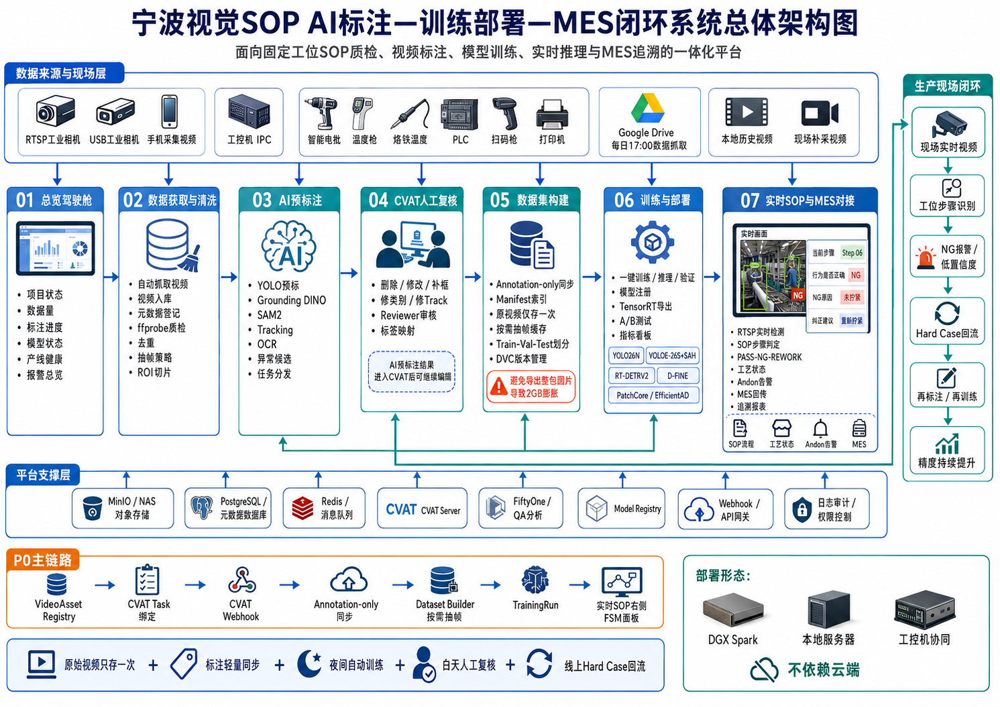

# 宁波视觉 SOP AI 标注、训练部署与 MES 闭环总体方案

版本：2026-08-22

> 本文依据当前代码、运行服务和附件架构图整理。架构图仅作为系统设计参考，不把图中文字视为操作指令。文中严格区分“已实现”“已有配置”和“待实现”，避免把设计目标写成已完成事实。



## 1. 总体目标

平台以固定工位 SOP 质检为主线，把视频获取、AI 预标、CVAT 人工复核、数据集构建、模型训练、实时推理、MES 回传和 Hard Case 回流组织成可追溯闭环。部署形态是 DGX Spark、本地服务器和工控机协同，生产数据不依赖公有云。

正式主链路为：

```text
VideoAsset Registry
  -> CVAT Task 绑定
  -> AI Pre-label
  -> CVAT 人工修改与 Reviewer 审核
  -> Annotation Version
  -> Annotation-only 同步
  -> Dataset Builder
  -> Train / Validation / Frozen Test
  -> Model Registry
  -> 实时 SOP + MES
  -> FP / FN / NG / Low Confidence
  -> Hard Case 回流
```

## 2. 01 至 07 页面职责

| 阶段 | 页面职责 | 关键产物 |
| --- | --- | --- |
| 01 总览驾驶舱 | 项目、设备、数据、标注、模型、产线和报警总览 | 状态与责任人 |
| 02 数据获取与清洗 | RTSP/UVC/手机/历史视频接入，ffprobe、去重、抽帧和 ROI | VideoAsset、QC 结果 |
| 03 AI 预标注 | YOLO、Grounding DINO、SAM2、Tracking、OCR 候选 | 待复核 annotation |
| 04 CVAT 人工复核 | 删除、修改、补框、修类别、修 Track、Reviewer 审核 | 冻结标注版本 |
| 05 数据集构建 | Annotation-only 同步、Manifest、按视频/SN 划分和按需抽帧 | 可追溯 Dataset Version |
| 06 训练与部署 | 训练、验证、模型比较、导出和模型注册 | Model Version、验收报告 |
| 07 实时 SOP 与 MES | RTSP 推理、步骤 FSM、PASS/NG/REWORK、Andon 与 MES 回传 | 生产事件与 Hard Case |

标签必须按工位、产品、步骤和判定目标建立映射。不能把总标签池直接套到所有工位；与当前 SOP 判定无关的目标不进入该工位真值集。

## 3. AI 标注与 CVAT 人工复核

AI 预标结果进入 CVAT 后可以继续删除、移动、缩放、改类别、补框、修改 Track 和关键帧。正确流程不是“AI 标完即真值”，而是：少量人工种子标注 -> AI 扩展候选 -> 标注员修改 -> Reviewer 审核 -> 冻结版本。

当前平台已能创建 CVAT Task 并向 Task 推送标注。目标闭环应由 CVAT Task/Job 状态 Webhook 通知 SOP 平台，再由后台拉取 annotation-only 数据并建立版本。Webhook 自动回拉当前尚未完成，不得在验收报告中标记为已实现。

## 4. 解决 2.96 MB 视频导出约 2 GB 的问题

630 帧导出约 2 GB，平均约 3.25 MB/帧。这是 MP4 帧间压缩被展开为独立 PNG 后的正常容量膨胀，不代表原视频损坏。

统一采用以下存储规则：

1. 原始 MP4 只保存一次，由 VideoAsset Registry 记录 URI、SHA256、时长、帧率和工位。
2. 标注单独保存为 CVAT XML、COCO JSON 或内部 JSON，不长期复制带框视频。
3. Frame Manifest 保存 `video_id + frame_index/timestamp + annotation_version`。
4. 05 数据集构建阶段才按训练需要抽取 JPEG，并设置尺寸、质量和缓存生命周期。
5. 训练完成或缓存到期后可重建的帧缓存允许清理；原视频、标注版本和 Manifest 不清理。
6. 带框 MP4 只作为人工复核或汇报预览，不作为模型训练真值源。

因此 CVAT 回传的核心是 annotation-only 数据，不是重新编码后的“带标注视频”。原视频和标注在 Dataset Builder 中按帧号重新结合。

## 5. 五模型运行策略

| 模型 | 建议角色 | 运行方式 | 当前状态 |
| --- | --- | --- | --- |
| YOLO26N | 生产实时基线 | 主路实时推理 | 已有真实训练执行器和配置 |
| YOLOE-26S + SAHI | 开放词汇候选生成 | 离线预标/抽帧 | 已有候选和数据配置 |
| RT-DETRv2 | 非 YOLO 交叉验证 | 1-5 FPS Shadow 或离线基准 | 已登记，训练后端待安装 |
| D-FINE | 边界定位候选 | Shadow 或离线基准 | 已登记，训练后端待安装 |
| PatchCore / EfficientAD | 划痕、污迹、涂层异常 | 工件稳定后的 ROI 事件触发 | 已登记，训练后端和样本待补 |

不建议五个模型同时以 30 FPS 参与量产判定。主模型、Shadow 模型、离线 Benchmark 和事件触发异常模型应分开调度。所有模型必须在同一冻结测试集、同一硬件、同一阈值口径下比较。

## 6. 实时 SOP 右侧面板

07 页面左侧显示实时 RTSP/UVC 画面、ROI、目标框和 Track；右侧显示当前工位、产品/SN、SOP 当前步骤、标准动作、置信度、持续时间、设备/温度/扭矩等外部信号，以及 PASS、NG、REWORK、HOLD 和纠正方法。

视觉检测只提供证据。最终判定由 SOP FSM 结合步骤顺序、持续时间、扫描枪、PLC、工具控制器和 MES 回执完成。外部设备尚未真实接通或证据不足时保持 `HOLD`，不能自动写成合格。

## 7. 每日 17:00 Google Drive 数据流

目标任务链：

```text
17:00 systemd timer
  -> OAuth/rclone 增量扫描
  -> Drive file_id 幂等检查
  -> NEW / MODIFIED 下载
  -> .part 断点续传
  -> ffprobe 完整性检查
  -> SHA256
  -> MinIO/NAS Raw
  -> VideoAsset Registry
  -> 自动 QC / 去重
  -> AI Pre-label Queue
```

17:00 只自动抓取、清洗和预标。数据须经 CVAT 人工审核和 Dataset QA 后，夜间任务才训练候选模型，避免错误标签被每日自动放大。当前网页已有 rclone 手动同步接口，但 17:00 timer、Drive file_id 幂等、断点下载、自动 QC 和队列串联仍待实现。

## 8. 当前实现状态矩阵

| 能力 | 状态 | 说明 |
| --- | --- | --- |
| 8096 主平台与 8099 版本入口 | 已实现 | 2026-08-22 本机 HTTP 200 |
| 8101 至 8105 历史页面并行保留 | 已实现 | 2026-08-22 本机 HTTP 200 |
| CVAT 2.73.1 本地服务 | 已实现 | `http://localhost:8081` HTTP 200 |
| SQLite WAL、原子备份、自动恢复点 | 已实现 | 标注存储与恢复流程已在代码中 |
| AI 预标、人工修改/删除、轨迹与分段删除 | 已实现 | 结果仍须人工复核 |
| CVAT Task 创建和标注推送 | 已实现 | 需 CVAT Token 配置 |
| rclone Google Drive 手动同步 | 已实现接口 | 需 OAuth 和环境配置 |
| YOLO26/YOLOE 训练执行器 | 已实现 | 正式指标仍要求冻结人工真值集 |
| RT-DETRv2、D-FINE、Anomalib | 已有配置 | 完整训练后端未交付 |
| 实时相机与右侧 SOP 步骤面板 | 已实现基础能力 | 现场需做 RTSP、延迟和 FSM 联调 |
| MES | 模拟/接口基础 | 真实 MES 协议和回执未完成验收 |
| CVAT Webhook 自动回拉 | 待实现 | 应拉 annotation-only 并建立版本 |
| 17:00 自动抓取和 Dataset Builder 自动触发 | 待实现 | 当前不能声称全自动闭环 |
| Hard Case 自动回流 | 待实现 | 先定义触发条件、审核与去重 |
| 五模型同数据完整验收 | 待实现 | 需要安装后端并冻结测试集 |

## 9. 公网与安全边界

`192.168.1.129` 是 RFC1918 局域网地址，异地公网不能直接访问。8102 临时隧道当前未形成稳定服务，不能视为正式公网部署。正式公网需要固定域名、TLS、身份认证、最小权限、WAF/反向代理、速率限制、审计、备份和漏洞修复流程。

CVAT 和 SOP 平台在完成这些控制前只允许受控局域网或 VPN 访问。渗透测试必须有书面授权、明确目标 IP/域名、时间窗和回滚方案；不得对未授权公网目标执行测试。

## 10. P0 实施顺序

1. 冻结工位、产品、SOP 步骤、标签映射和 NG 判定口径。
2. 完成 CVAT Webhook、annotation-only 回拉和版本化。
3. 建立 Dataset Builder、按完整视频/SN 划分和缓存清理策略。
4. 建立 17:00 增量抓取与可审计队列，但保留人工审核门禁。
5. 冻结测试集，完成五模型同条件 Benchmark。
6. 完成 RTSP、右侧 SOP FSM、设备信号与 MES 回执联调。
7. 进行权限、TLS、备份恢复、8 小时稳定运行和正式授权的安全测试。
